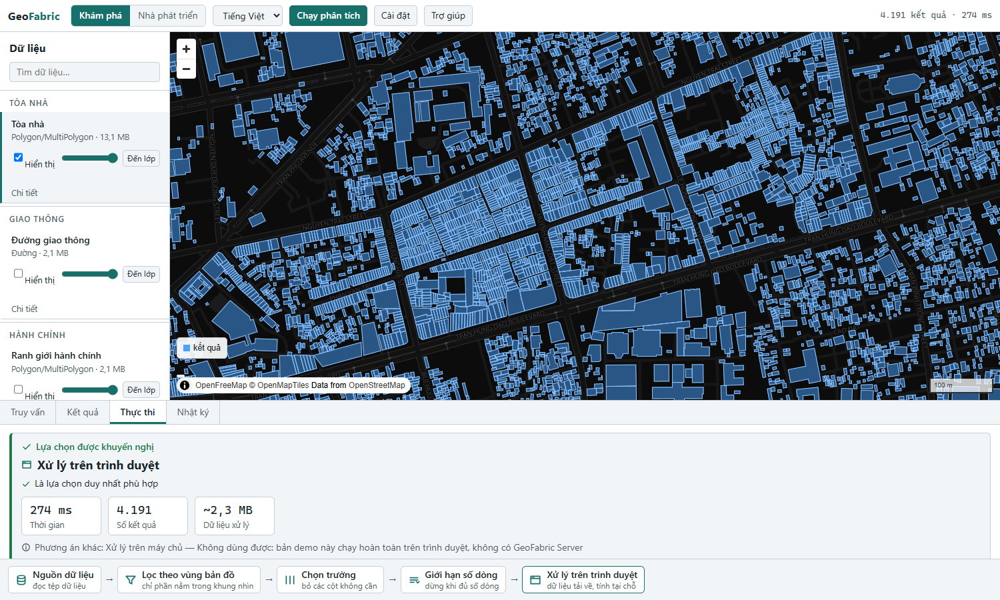
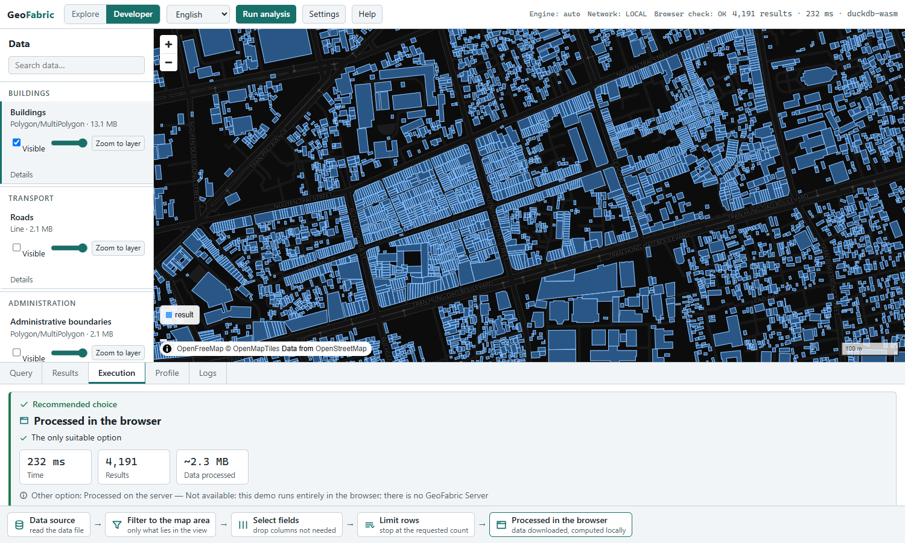

# GeoFabric

**An experimental, browser-first spatial runtime for cloud-native geospatial data.** A logical plan (the *PlanGraph*, a versioned Spatial IR) is planned once and runs on interchangeable engines: **DuckDB-Wasm in your browser**, DuckDB on a server, or PostGIS. The server is optional. PostGIS is optional.

<!-- LIVE-DEMO -->

> Status: **alpha / experimental.** It is a research-grade runtime with real correctness evidence (cross-engine result equality, an independent oracle for the metric-distance demo), not a production product. See [Known limits](#known-limits).

## What can I try right now?

Open the **public demo** (no install, no account, nothing runs on a server): a real map of central Ho Chi Minh City with **real Overture buildings, roads, places and boundaries**, queried by **DuckDB-Wasm in your own browser** straight from GeoParquet files by HTTP range requests.

- pan/zoom: the visible buildings are queried live (a spatially representative sample is drawn when a view holds more than the draw budget; counts are always the full logical count),
- click a feature to inspect it, filter by an attribute, count by a category,
- switch Vietnamese / English; switch to **Developer** mode to see the PlanGraph, the generated SQL, the planner's view and which engines this deployment has.

Analyses that need a server (metric distance such as "buildings within 200 m of main roads", spatial joins, exact intersection) are shown as disabled with the reason: *"This analysis requires GeoFabric Server."* They are never approximated.

| Explorer (Vietnamese) | Developer (English) |
|---|---|
|  |  |

## How it fits together

```
                       GeoFabric UI  (MapLibre, Explorer / Developer, vi / en)
                              |
                          PlanGraph        versioned Spatial IR (0.3): the same plan everywhere
                              |
                           Planner         observable decisions: capabilities, cost, risk, health
                  /           |            \
          DuckDB-Wasm      DuckDB         PostGIS             <- execution engines (replaceable adapters)
           (browser)      (server)        (server)
              |              |               |
     GeoParquet / PMTiles    files        database            <- data
        by range request
```

* **Static public demo** = the browser branch only: UI + MapLibre + DuckDB-Wasm + public GeoParquet. No gateway, no database, no tunnel.
* **Full stack** = the optional server branches behind the same plan and planner.

Three supported deployment profiles (details in [docs/deployment-profiles.md](docs/deployment-profiles.md)):

| Profile | What runs | Needs |
|---|---|---|
| **A. Static browser** (the public demo) | UI + MapLibre + DuckDB-Wasm + cloud-native data | any static host (GitHub Pages) |
| **B. Local full stack** | UI + Gateway + DuckDB server (+ optional PostGIS) | Rust, Node, Python on your machine |
| **C. Self-hosted server** | Gateway + server engines + your storage (+ optional PostGIS) | your infrastructure (not packaged here) |

## Run it yourself

### Static browser profile (what is deployed)

```
cd web
npm ci
npm run build:static            # GF_BASE=/geofabric/ for a sub-path host such as GitHub Pages
npx vite preview --outDir dist  # then open the printed URL
```

The data pack (`data/public-demo/`, 26 MB) is copied next to the site by the build. It is regenerated from a local Overture extract with `data/scripts/make_public_demo.py`.

### Local full stack (Windows, one-time setup)

Prerequisites: Rust ≥ 1.99, Node ≥ 24, Python ≥ 3.12.

```
python tools/duckdb_prebuilt.py     # downloads libduckdb, checks the sha256 pinned in tools/duckdb-prebuilt.lock.json
export DUCKDB_LIB_DIR="<printed dir>"; export PATH="$DUCKDB_LIB_DIR:$PATH"
cd web && npm ci && npm run build && cd ..
cargo run -p geo-gateway --no-default-features -- --data benchmarks/data --port 8787   # then open http://127.0.0.1:8787
```

`start-ui.bat` does the same on Windows. Real data (optional, ~1.5 GB, public Overture release, never committed): see [data/README.md](data/README.md). The first run of the DuckDB adapter downloads DuckDB's `spatial` extension once.

### Optional: PostGIS

PostGIS is an *optional* engine, verified live against PostgreSQL 16.9 / PostGIS 3.6.2 (strict data parity, 17 plans identical to DuckDB, an independent oracle for the 200 m metric demo): [docs/postgis.md](docs/postgis.md), [ADR-013](adr/ADR-013-postgis-engine.md). Nothing in the static demo or the default stack needs it; it is off unless you configure it.

## Checks

```
cargo test --workspace --no-default-features          # Rust (live PostgreSQL tests skip without a server: a skip is not evidence)
python tools/arch_check.py                            # dependency-boundary rules from the Constitution
cd web && npm run typecheck && npm test               # TypeScript unit tests
cd web && npx playwright test -c playwright.static.config.ts   # static-mode browser tests (no gateway, no PostGIS)
```

## Principles

[CONSTITUTION.md](CONSTITUTION.md) (the invariants), [AGENTS.md](AGENTS.md), [docs/vision.md](docs/vision.md), [rfcs/](rfcs/), [adr/](adr/). Highlights: CRS and units are never implicit; GeoJSON is only a boundary format; the IR does not depend on any engine; every optimization needs benchmark evidence; the planner's decisions are observable; AI never executes unvalidated SQL.

## Data, licences and privacy

* **Code:** MIT OR Apache-2.0 ([LICENSE-MIT](LICENSE-MIT), [LICENSE-APACHE](LICENSE-APACHE)).
* **Data:** the demo pack is a small **derived database of [Overture Maps](https://overturemaps.org) data**, which includes OpenStreetMap-derived data under the **ODbL** (share-alike). It carries the required attributions, shown on the map and in [docs/DATA-LICENSES.md](docs/DATA-LICENSES.md). The pack is offered under the ODbL; the code licence does not apply to it.
* **Basemap:** OpenFreeMap / OpenMapTiles / OpenStreetMap, attribution shown on the map. The basemap host can see which map tiles you view.
* **Third-party code at runtime:** DuckDB-Wasm downloads its `parquet` extension (code, not data) from DuckDB's official extension CDN, `extensions.duckdb.org`, on first use.
* **No analytics, no cookies, no tracking.** Your queries run in your browser; nothing about them is sent anywhere. See [SECURITY.md](SECURITY.md).

## Known limits

* The browser engine runs a subset of the plan (scan, filter, bbox, aggregate, project, sort, limit). Metric distance, spatial joins and exact intersection need a server engine.
* The planner's cost model is calibrated for DuckDB; PostGIS has no calibrated cost model (the planner never picks it on predicted cost).
* One development machine produced all measurements; the public demo's pack is a single roughly 9 km × 8 km window of central Ho Chi Minh City.
* Not production-ready, not a distributed system, not a universal GIS: it is a runtime for studying one plan on several engines with evidence.

## Contributing and security

[CONTRIBUTING.md](CONTRIBUTING.md) · [SECURITY.md](SECURITY.md)

---

*Tiếng Việt:* GeoFabric là lớp chạy GIS thử nghiệm, ưu tiên trình duyệt: cùng một kế hoạch truy vấn (PlanGraph) chạy trên DuckDB-Wasm ngay trong trình duyệt, trên DuckDB máy chủ hoặc PostGIS. Bản demo công khai chạy hoàn toàn trên trình duyệt, không cần cài đặt; máy chủ và PostGIS chỉ là tuỳ chọn.
